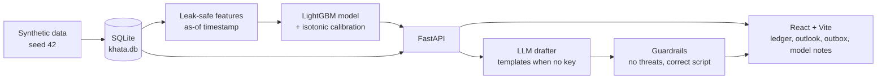

# TenantEase Khata

A rent-ledger prototype for small landlords. It reads the last few months of rent
payments, works out which leases are likely to pay late in the coming cycle, and
helps a manager send a well-timed, human reminder. The risk score only decides how
early and how personally to remind someone; it never decides rent, eviction, or
whether to take a tenant.

## The opportunity in three sentences

Small landlords lose time chasing rent after it is late, when a single well-timed
message a few days earlier would have been enough. The signal to act is already in
their own payment history. This prototype turns that history into a short daily
worklist and a ready draft message, so the follow-up happens before the arrears
build up.

## Architecture



- **Backend** (`backend/`): FastAPI, SQLModel/SQLite, pandas, scikit-learn,
  LightGBM, SHAP. Synthetic data, feature pipeline, model, evaluation, reminder
  planner and LLM drafter.
- **Frontend** (`frontend/`): Vite + React + TypeScript. Plain CSS driven only by
  `src/styles/tokens.css`. Hand-built SVG for the stamps, the risk stroke and the
  charts. No UI kit, no chart library, no Tailwind.

## Quick start

```sh
make setup     # install backend and frontend dependencies
make seed      # generate the synthetic SQLite database
make train     # build features and train the model
make eval      # write metrics, slices, model card, llm eval
make report-assets   # figures into docs/figures, docs/eval_report.md
```

Then run the two servers in separate terminals:

```sh
make api       # FastAPI on http://localhost:8000
make web       # Vite dev server on http://localhost:5173
```

`make check` runs ruff, pytest, `tsc` and the frontend build.

### One command with Docker

```sh
docker compose up --build
```

This seeds, trains and serves the app at http://localhost:8080 with no API key
needed. The backend image runs the same pipeline and reuses trained artifacts on
restart.

## Environment variables

| Variable | Default | Purpose |
|---|---|---|
| `DATABASE_URL` | `sqlite:///backend/data/khata.db` | Database location |
| `SEED` | `42` | Seed for reproducible synthetic data |
| `LLM_PROVIDER` | `none` | `none`, `anthropic`, `openai` or `ollama` |
| `LLM_MODEL` | `claude-3-5-haiku-latest` | Model name for the chosen provider |
| `ANTHROPIC_API_KEY` | — | Key variable when `LLM_PROVIDER=anthropic` |
| `OPENAI_API_KEY` | — | Key variable when `LLM_PROVIDER=openai` |
| `USE_OCCUPATION` | `true` | Whether occupation type is a model feature (ablation flag) |
| `ENABLE_ADMIN_RESEED` | `false` | Gates the dev-only reseed endpoint |

With `LLM_PROVIDER=none` the drafter uses templates, so the whole demo runs
offline. If a provider is set but fails or returns text that breaks a guardrail,
the drafter retries once and then falls back to a template; the drawer says so.

## What is synthetic

Everything. Names, units, rents, payments and messages are generated by Faker
(`en_IN`) with a fixed seed. There is no real tenant data anywhere. The model card
and the eval report say plainly that the metrics come from planted effects and are
not a forecast of production accuracy.

## The 90-second demo

1. Open the ledger and watch the stamps land on the current cycle.
2. Tick "Highest risk first" and read the late-risk strokes at the end of each row.
3. Open a high-risk tenant and read "Why this score" in plain sentences.
4. Read the reminder plan: which day, which channel, friendly or neutral.
5. Draft a Hinglish message, watch the guardrails pass, and edit a line to see a
   guardrail fail and block approval.
6. Press "Approve reminder" and see the APPROVED stamp land.
7. Open Outlook and move the two follow-up sliders (the label stays
   "Assumption-based, not measured").
8. Open Model notes and read "What this does not show".

Screenshots for each page at 1440px and 390px live in `docs/screenshots`.

## Honest answers to likely questions

- **Is the model good?** On synthetic data it beats a rule baseline on PR-AUC and
  sits in the 0.78 to 0.86 ROC-AUC range. That shows the pipeline works, nothing
  more.
- **Does it prove reminders help?** No. The what-if on the outlook page is
  assumption based. Measuring a nudge needs a real A/B test.
- **What about fairness?** Name, phone, property, locality and language are not
  features. Occupation type is allowed but ablated in the model card. The score
  drives scheduling only, never a decision about a person.
- **What if there is no API key?** The app falls back to templates that already
  pass every guardrail, so the demo is fully offline.
