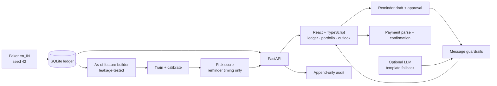

# TenantEase Khata

TenantEase Khata is a synthetic-data prototype for rent collection: it turns a manager's historical payment ledger into a leak-safe late-payment reminder worklist, lets the manager inspect reasons and a reminder plan, drafts a guarded message, and requires human approval; scores are for reminder scheduling only and are never used for eviction, rent pricing, or tenant screening.

**Live demo:** Not deployed. Run the local demo with the commands below. Set the link here when a public deployment is available.

**Colab:** [Reproduce the synthetic model evaluation](https://colab.research.google.com/github/agniv-dutta/TenantEase/blob/main/notebooks/tenantease_demo.ipynb) · [Full risk-model walkthrough](https://colab.research.google.com/github/agniv-dutta/TenantEase/blob/main/notebooks/tenantease_risk_model.ipynb)

## Evaluation metrics

<!-- metrics:start -->
| Model | PR-AUC | ROC-AUC | Brier score | Top 10% precision |
|---|---:|---:|---:|---:|
| Shipped calibrated model | 0.3180 | 0.6882 | 0.1313 | 0.4423 |
| Late-last-cycle baseline | 0.2754 | 0.6534 | 0.1913 | 0.4615 |

Evaluation set: 528 lease-cycle rows; base rate 0.1667. Synthetic data only; not a forecast of production accuracy.
<!-- metrics:end -->

The table above is generated from `backend/app/ml/artifacts/metrics.json`. Refresh it after evaluation with:

```sh
python backend/scripts/update_readme_metrics.py
```

All metrics are from seeded synthetic data. They are not evidence of production accuracy or tenant outcomes. See the [model card](docs/model_card.md) and [evaluation report](docs/eval_report.md).

## Architecture



- `backend/`: FastAPI, SQLModel, SQLite, seed generator, feature pipeline, LightGBM, calibration and evaluation.
- `frontend/`: Vite, React, TypeScript, token-based CSS and hand-built SVG charts.
- `docs/`: synthetic data description, model card, evaluation report, opportunity and technical approach reports, screenshots and submission checklist.

## Quick start

```sh
make setup
make seed
make train
make eval
make api       # terminal 1
make web       # terminal 2
```

The app opens at `http://localhost:5173`. `make check` runs the backend and frontend checks. `docker compose up --build` starts the local demo on port 8080. No LLM key is required; the reminder drafter falls back to templates.

## Two-minute keyboard demo

Start at the landing page and use the keyboard throughout:

1. Tab to **Open the ledger** and press Enter. The ledger is sorted highest risk first.
2. Tab through the ledger rows to the first high-risk lease and press Enter. Read **Why this score** and the reminder plan in the drawer.
3. Tab to **Language**, choose **Hinglish**, then Tab to **Draft reminder** and press Enter. Review the message and checks; Tab to **Approve** and press Enter.
4. Tab to **Payments** in the left navigation. Paste a synthetic payment message, parse it, review the candidate and fields, then confirm the payment.
5. Open **Portfolio** and review occupancy, collection efficiency, revenue and vacancies.
6. Open **Outlook**, Tab to both sliders, and adjust them with the arrow keys. The what-if is assumption-based, not measured.
7. Open **Model notes** and read **What this does not show**.

Nothing sends a message automatically. The demo dataset may be changed by a payment confirmation; `make seed` restores it.

## What is synthetic

All tenants, properties, units, payment messages and rent outcomes in the demo are generated. Tenant names and phone numbers use Faker's `en_IN` locale; the seed defaults to 42. The data generator plants known payment-risk effects and deterministic vacancy gaps. See [`docs/synthetic_data.md`](docs/synthetic_data.md). Payment parser fixtures are generated from synthetic seeded tenants. No real tenant records are used.

## What is assumed

- The 5-day grace window defines on-time collection for collection-efficiency reporting.
- The current-cycle outlook and reminder what-if use model probabilities and an assumed effect; no reminder treatment effect has been measured.
- The payment parser ranks possible leases but cannot confirm a payment. A manager selects and confirms the record.
- The score supports reminder scheduling only. Every message requires review and approval.

## Limitations

The model and parser are evaluated on synthetic, planted data. This does not establish real-world accuracy, fairness, causal impact, or suitability for decisions about a tenant. The app has no production identity, access control, payment-provider integration, or deployment hardening. External demo hosting is required for the live link above; the local quick start is not a public deployment.

## Reports and artifacts

- [AI Opportunity Report](docs/ai_opportunity_report.md)
- [Technical Approach Report](docs/technical_approach_report.md)
- [Synthetic data process](docs/synthetic_data.md)
- [Model card](docs/model_card.md)
- [Evaluation report](docs/eval_report.md)
- [Submission checklist](docs/submission_checklist.md)
- [Colab notebook source](notebooks/tenantease_demo.ipynb)
- [Risk-model notebook source](notebooks/tenantease_risk_model.ipynb)
- [Screenshots](docs/screenshots/)
